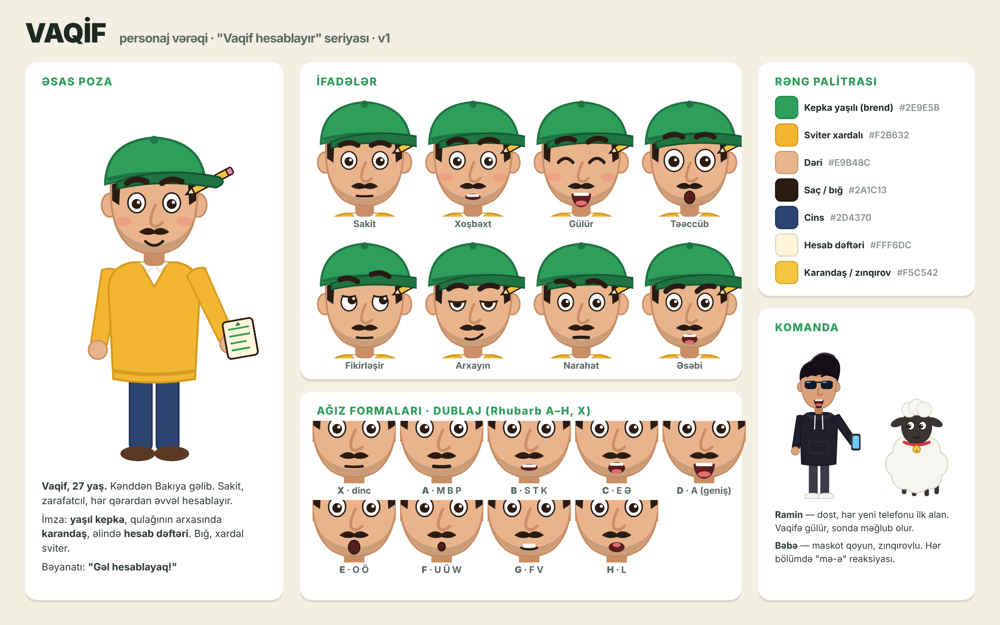
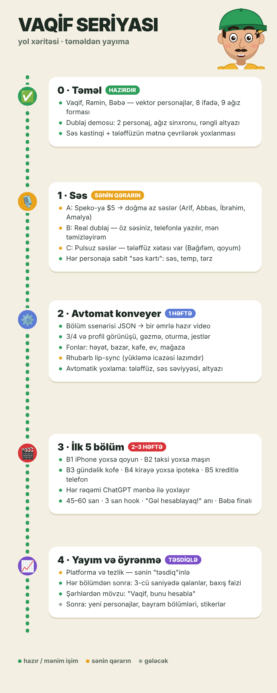

# Vaqif hesablayır — seriya bibliyası

Davamlı qısa video seriyası. Hər bölümdə Vaqif bir pul və ya həyat seçimini real rəqəmlərlə hesablayır.

## Personajlar

| Personaj | Kimdir | Görünüş (dəyişməz) | Rolu |
|---|---|---|---|
| **Vaqif** (27) | Kənddən Bakıya gəlib. Sakit və zarafatcıldır, hər qərardan əvvəl hesablayır. | yaşıl kepka `#2E9E5B`, qulağının arxasında karandaş, əlində hesab dəftəri, bığ, xardal sviter `#F2B632` | Qəhrəman. İmza sözü: **"Gəl hesablayaq!"** |
| **Ramin** | Vaqifin dostudur, hər yeni telefonu ilk alır. | qara hudi, yuxarı daranmış saç, gün eynəyi, əlində telefon | Komik rəqib: sataşır, sonda uduzur |
| **Bəbə** | Maskot qoyun | ağ yun, qara üz, qırmızı boyunluq, sarı zınqırov | Hər bölüm "mə-ə!" ilə bitir |
| **Rəvayətçi** | Kadr arxasından danışan səs | — | Rəqəmləri izah edir (indiki səs: Adrian) |

**Dəyişdirmək olmaz:** kepkanın rəngi və forması, karandaş, bığ, sviterin rəngi, Bəbənin zınqırovu. Hər bölümdə eyni qalır, çünki tamaşaçı personajı bu əlamətlərdən tanıyır.

## Bölüm formatı (45–60 san)

| An | Nə olur |
|---|---|
| 0–3 san | **Hook:** Ramin sataşır, ya da şok rəqəm göstərilir. Logo və giriş yoxdur. |
| 3–8 san | Vaqif: "Gəl hesablayaq!" — dəftəri qaldırır |
| 8–45 san | 3–4 hesab addımı. Görüntü hər 2–4 saniyədə dəyişir, hər rəqəm animasiya ilə gəlir |
| 45–55 san | Gözlənilməz nəticə, Ramin məğlub olur |
| son | Bəbə "mə-ə!" deyir, növbəti bölüm bir cümlə ilə anons olunur, son kadr başlanğıca qayıdır (loop) |

**Hər bölümdə mütləq olur:** natiqin adı və rəngi ilə altyazı, "Təxmini hesablama" qeydi, mənbəsi yoxlanmış rəqəmlər.

## İstehsal axını (peşəkar dublaj modelinə əsasən)

1. **Ssenari** — Claude yazır: səhnə, personaj, sətir, ifadə, kamera.
2. **Fakt yoxlaması** — ChatGPT hər rəqəmə mənbə tapır.
3. **Kastinq** — hər personajın sabit səsi var (səs kartı).
4. **Take-lər** — hər sətir ayrıca yazılır. Səhv çıxan sətir yalnız özü yenidən yazılır.
5. **Tələffüz yoxlaması** — hər take mətnə çevrilir və ssenari ilə tutuşdurulur.
6. **Ağız sinxronu** — səsdən kadr-kadr ağız forması çıxarılır (`demo/lipsync.py`).
7. **Animasiya və render** — `rig.js` + səhnə HTML → Playwright → kadrlar.
8. **Miks** — dialoq + effektlər, səs səviyyəsi -14 LUFS.
9. **Son yoxlama (QC)** — kadr, altyazı və səs yoxlanır.
10. **Yayım** — yalnız Fəridin "təsdiq"indən sonra.

## Fayllar

| Fayl | Nədir |
|---|---|
| `rig.js` | Vaqif, Ramin və Bəbənin SVG rig-ləri: ifadə, ağız forması, göz qırpma, baxış istiqaməti, qol, yırğalanma |
| `sheet.png` / `sheet.html` | Personaj vərəqi |
| `roadmap.png` | Yol xəritəsi |
| `demo/vaqif_tanisliq_demo.mp4` | 19,5 san tanışlıq demosu: dialoq, ağız sinxronu, kamera hərəkəti |
| `demo/lipsync.py` | Səsdən ağız formaları çıxaran skript (Rhubarb sistemindəki A–H və X formaları) |
| `kastinq/*.wav` | Səs nümunələri, qulaqla seçmək üçün |

Araşdırma qeydləri və mənbələr: [ARASDIRMA.md](ARASDIRMA.md)

## Yol xəritəsi

### Fəridin qərarları

1. **Səs.** Üç variant var:
   - **A:** Speko-ya $5 yüklənir. Bundan sonra ElevenLabs-da doğma Azərbaycan dilində danışan səslərdən (Arif, Abbas, İbrahim Məmmədli, Amalya) istifadə etmək olur.
   - **B:** Real dublaj — personajları sizin və dostlarınızın səsi ilə yazırıq.
   - **C:** Pulsuz səslərlə davam edirik. Bu variantda tələffüz xətaları qalır.
2. **Rhubarb Lip Sync** — kənar proqram faylını yükləməyə icazə lazımdır. Sistem bunu icazəsiz rədd etdi.
3. **Seriyanın adı** — "Vaqif hesablayır" təklifdir.
4. **Platforma və yayım tezliyi.**
5. **Dizayn** — kepka, bığ və yaş bəyənildimi? Bəyənilsə, dizaynı dondururuq.
